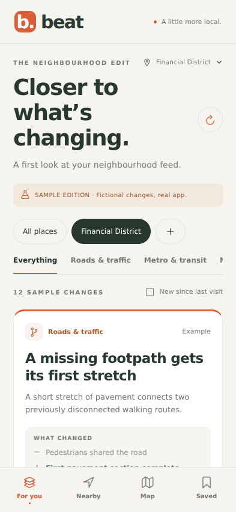

# Verification

Prototype verified in the build workspace:

- TypeScript typecheck passed.
- 13 Node tests passed: geography, feed filtering, input validation, evidence validation, state transitions including reversals, repeat suppression, database reopen, API authorization and a mocked end-to-end discovery run.
- Expo exported Android, iOS and web bundles.
- Browser interaction smoke test passed at 393 × 852: onboarding, feed loading, saving a card, Saved view, evidence detail, following an entity, reload persistence, category filtering and adding Lynnwood. No uncaught browser errors or horizontal document overflow.
- Onboarding, feed and detail screenshots were visually inspected.

Not verified: a real paid discovery run (no provider key configured), factual precision of generated reports, PostgreSQL integration, a physical phone, signed APK/IPA builds or store submission. Native bundle export does not replace a device test.

